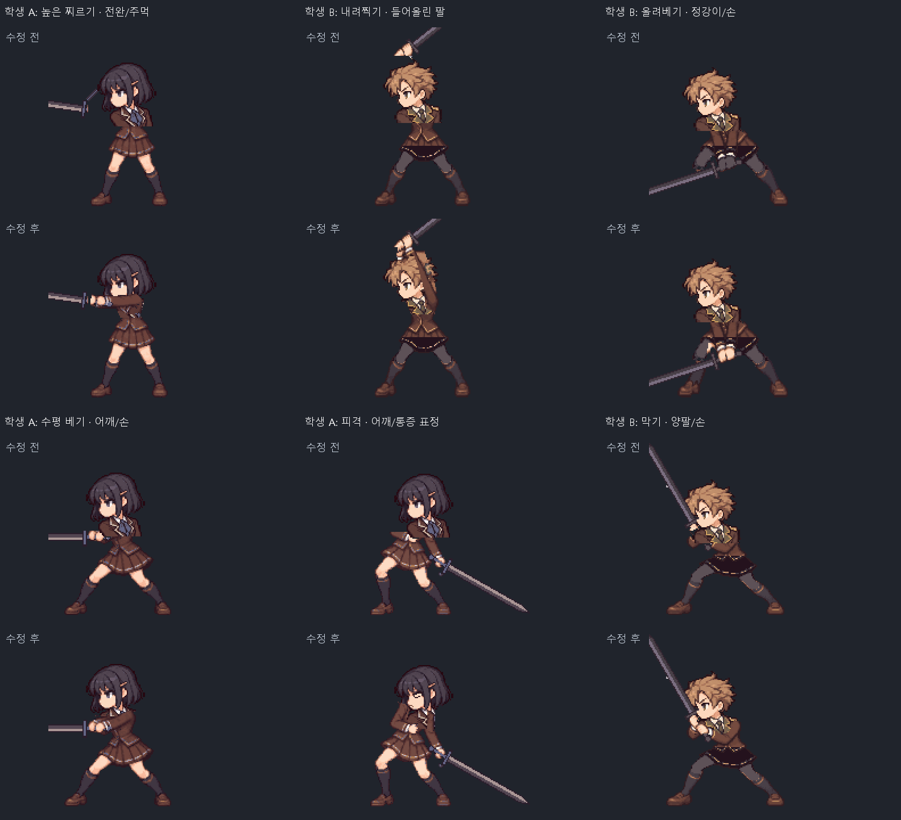
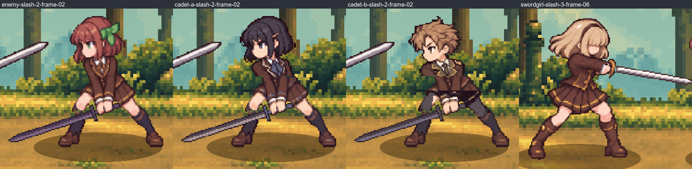
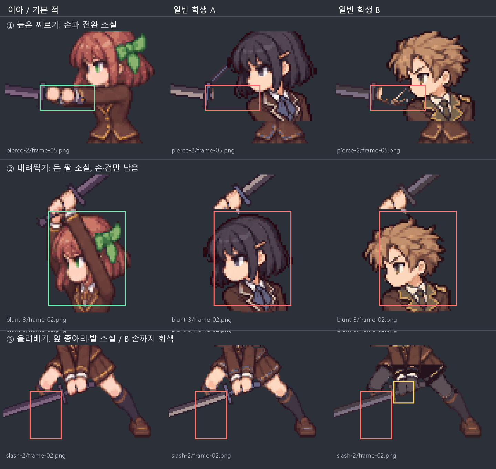
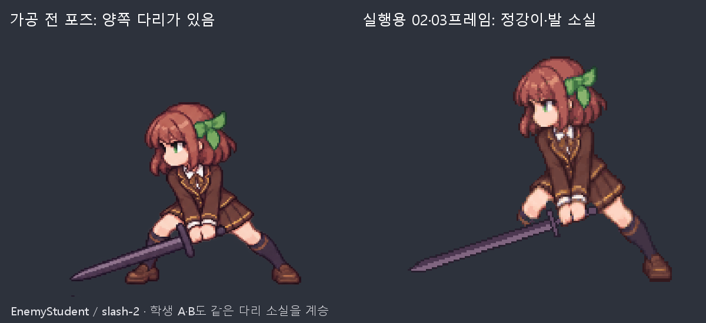
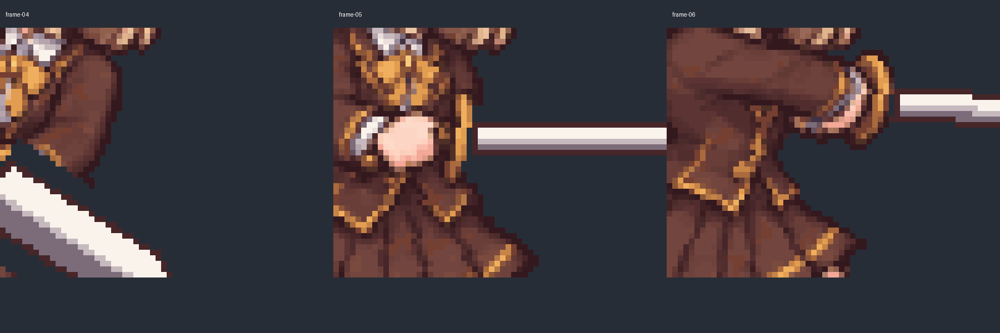

# 캐릭터 애니메이션 재검수

점검일: 2026-10-16 (KST) · 수정 완료: 2026-10-17 (KST)  
기준 커밋: `e8e62457d888037117021331bc3a52cc75da1731`

## 수정 결과 — 2026-10-17

확인된 파손 102장과 추가 검토 구간 9장을 합쳐 **실행 PNG 111장**을 수정했다. Aseprite의 픽셀 편집으로 기존 포즈의 팔·손·다리를 복원하고, 캐릭터별 의상색과 앞뒤 겹침을 정리했다. 아래 1–6절의 결함 설명과 비교 이미지는 **수정 전 검수 기록**이다.

| 수정 대상 | 실행 PNG | 수정 내용 |
| --- | ---: | --- |
| Cadet A/B | 각 53, 총 106 | 누락된 어깨·상완·전완·손 복원, 올려베기 준비의 정강이·발 복원, B의 회색 손 수정, 막기·피격 자세와 통증 표정 복원. 추가로 수평 베기 05–07의 팔 연결과 잔여 소매·머리 픽셀 정리 |
| EnemyStudent | 2 | 올려베기 준비 02·03의 정강이·신발 복원. 기존 불투명 픽셀 보존 |
| SwordGirl | 1 | 수평 베기 3의 06번: 손잡이를 감싼 주먹·커프스 재작화, 검날을 72px/10도로 수정해 05→06→07의 급격한 축소 완화 |
| 상급기사용 MobStudent | 2 | 폼멜 타격 1의 02·03: 오른쪽 타격 목표를 보는 머리와 목 연결. 검·칼막이·손·하체 보존 |

최신 편집 원본 네 개에도 수정 그림을 반영했다. 저장 후 다시 열어 **482프레임의 PNG 일치, 기존 프레임 시간·레이어·팔레트 보존**을 확인했다. SwordGirl의 선택 효과 레이어도 보존했다. Cadet A/B 각 14개와 기본 적 2개, 합계 **태그 구간 30개**를 수정했다.

Cadet A/B 제작 도구에는 검수한 픽셀 보정 자료를 마지막 단계에 적용하도록 연결했다. 격리 폴더에서 다시 생성한 **242장 모두 현재 실행 그림과 RGBA 전 픽셀이 일치**했다. 이 보정 자료는 현재 포즈의 좌표에 맞춰져 있으므로 새 자세를 그릴 때 함께 편집해야 한다.

Unity 6000.5.9f1의 별도 복사본에서 **24개 검사 통과, 실패·스킵 0**을 확인했다. 기존 검사 22개와 복사본 전용 임포트·카메라 검사 2개다. 캐릭터 484장의 가져오기·발 피벗을 확인하고 수정 자세를 실제 전장 카메라로 촬영·확대 검수했다. 최종 PNG 551장은 원 프로젝트와 검사 복사본의 해시가 일치했다. 이번 결과는 캐릭터 리소스 검증이며 플레이어 빌드와 전투 전체의 수동 플레이 검사는 포함하지 않는다.

[학생 공격 수정 전후 재생](CharacterAnimationAudit/Repairs/cadet-pierce-2-before-after.gif) · [주인공 그립 비교](CharacterAnimationAudit/Repairs/swordgirl-grip-comparison.png) · [상급기사 시선 비교](CharacterAnimationAudit/Repairs/senior-head-comparison.png) · [수정 파일·검증 자료](CharacterAnimationAudit/Repairs/README.md)

## 수정 전 재검수 결론

현재 실행용 그림에서 **서로 다른 PNG 102장에 신체 일부가 지워지거나 잘못 칠해진 파손**을 확인했다. 학생 A/B의 팔·손·어깨 소실 96장과 기본 적·학생 A/B의 정강이·발 소실 6장이다. 학생 B의 회색 손 2장은 다리 소실 파일과 겹친다. 이 수량은 앞뒤 프레임과 기본 적을 비교해 확인한 최소 범위다. SwordGirl의 그립과 검 회전은 별도의 재작화 대상으로 기록했다.

이전 점검의 “그 밖의 명백한 누락·절단을 확인하지 못했다”는 결론은 철회한다. PNG가 열리고 Aseprite 원본과 일치한다는 사실은 그림과 동작의 품질을 보증하지 않는다. 이번에는 확대 프레임 시트, 앞뒤 자세, 원화와 가공본 비교를 중심으로 검수했다.

[전체 파손 파일 목록](CharacterAnimationAudit/confirmed-defects.json) · [동일 동작 재생 비교](CharacterAnimationAudit/cadet-pierce-2.gif)

## 1. 학생 A/B — 팔과 손이 실제로 지워짐

기본 적에서는 팔꿈치·전완·손목·주먹이 이어지는 자리에 학생 A/B는 배경이 드러난다. 높은 찌르기는 손과 전완이 없어 검이 얼굴 옆에 떠 있고, 내려찍기 준비는 팔이 없어 머리 위에 손과 검만 남는다. 막기·피격 정지 자세에도 어깨와 팔이 수평으로 잘린 구간이 있다. 피격 얼굴도 대기용 머리로 덮여 원래의 통증 표정이 사라진다. 한 프레임의 잔상 과장이 아니라 여러 프레임 또는 정지 자세에 유지되는 파손이다.

두 캐릭터에 공통으로 확인한 범위는 다음과 같다. 프레임 번호는 파일명 기준 01부터 시작한다.

| 경로 / 동작 | 프레임 | 캐릭터당 장수 |
| --- | --- | ---: |
| `slash/frame-*.png` | 02–04 | 3 |
| `slash-2/frame-*.png` | 05–10 | 6 |
| `pierce/frame-*.png` | 05–08 | 4 |
| `pierce-2/frame-*.png` | 02–10 | 9 |
| `blunt/frame-*.png` | 02–09 | 8 |
| `blunt-2/frame-*.png` | 02–03, 05–10 | 8 |
| `blunt-3/frame-*.png` | 02–04, 08–10 | 6 |
| `poses/*.png` | block, block-2, hurt, hurt-2 | 4 |
| 합계 | A/B 각각 | 48 |

실행 폴더는 `Assets/Game/Resources/EnemyVariants/CadetA/Animations`와 `CadetB/Animations`다. 대응 편집 원본은 `Docs/Art/EnemyVariants/CadetA/CadetA-AllAnimations.aseprite`, `CadetB/CadetB-AllAnimations.aseprite`다. 이전 픽셀 대조에서 원본과 PNG가 일치했으므로 편집 원본에도 같은 파손이 들어 있다.

원인은 단순히 새 포즈를 생성하는 단계에만 있지 않다. 머리 교체 스크립트는 넓은 사각 영역을 투명하게 지운 뒤 검과 일부 손·소매만 조건부로 복원한다. 이 영역에 원래 팔이 겹친다. 실제 파손 경계와 이 처리가 일치한다.

- `Docs/Art/EnemyVariants/CadetA/Tools/build_cadet_a.lua`: 437–440행의 삭제 영역, 455–462행의 제한된 복원, 464행 이후 참격 전용 보정.
- `Docs/Art/EnemyVariants/CadetB/build_cadet_b.lua`: 423–427행의 삭제 영역, 447–455행의 복원, 505–520행의 추가 복원.

새 머리에 가려져야 하는 픽셀과 머리 앞에 남아야 하는 팔·손·검을 프레임마다 구분해야 한다. 큰 마스크를 지운 뒤 색상 조건이나 연결 픽셀만 복원하는 현재 방식으로는 신체 구조를 보존할 수 없다. `slash-3`의 05–07도 어깨·상완 연결을 추가 검토할 대상으로 남긴다(위 96장에는 포함하지 않음).

## 2. 기본 적과 학생 A/B — 정강이와 발 소실

대상은 세 캐릭터의 `Animations/slash-2/frame-02.png`, `frame-03.png`, 총 6장이다. 화면 왼쪽 허벅지가 무릎 근처에서 끝나고 그 아래 정강이·양말·신발이 없다. 뒤쪽 다리 하나만 남는다.

`Docs/Art/EnemyStudent/Expansion/slash-2_source.png`의 왼쪽 위 원화에는 검 뒤로 정강이와 신발이 존재한다. 따라서 이 결손은 원화에 없던 가공 결과다. `extract_poses.lua`는 기존 검을 색상·영역 조건으로 지우고 마지막에는 가장 큰 연결 조각만 남긴다(59행, 97–114행). 검과 색이 비슷한 양말 또는 가려진 다리의 연결을 잃은 뒤 제거됐을 가능성이 높다. 이 원인 경로는 아직 스크립트를 다시 실행해 분리 재현하지 않았으므로, 삭제가 일어난 정확한 단계는 수정 시 확인해야 한다.

02·03은 원본 시간으로 100+120ms 동안 같은 준비 포즈를 유지한다. 짧은 동작 과장이나 잔상으로 설명할 수 있는 한 장의 변형이 아니다.

## 3. 학생 B — 손이 바지 색으로 변함

`CadetB/Animations/slash-2/frame-02.png`, `frame-03.png`의 낮은 그립에서 양손이 피부색 대신 회색으로 칠해진다. 예를 들어 (121,164)의 RGB는 (93,81,87)로 `build_cadet_b.lua`의 바지 밝은색과 같다. 다른 자세의 손은 피부색이다.

바지 변환의 피부 연결 영역 판정(77–108행)과 의상 재색칠(401–407행)이 무릎 옆에 닿은 손까지 포함했을 가능성이 높다. 이 두 파일은 위 다리 소실 6장과 겹쳐 총량에 중복 계산하지 않았다.

## 4. SwordGirl — 그립과 검의 공간상 회전을 재작화할 구간

`Assets/Game/Resources/SwordGirl/Animations/slash-3/frame-06.png`는 05번의 둥근 주먹이 얇은 살색 띠로 눌리고, 소매·커프스가 금색 칼막이까지 이어진다. 손잡이를 감싼 손으로 읽히지 않는다. 알파 픽셀은 연결되어 있으므로 “검이 완전히 떨어졌다”는 판정과는 다르다.

03–07의 검날 길이는 제작 코드상 60→39→73→35→70px, 화면 각도는 180→32→0→4→20도다. 원근 단축은 의도되어 있지만, 특히 05→06은 거의 수평인 검이 급격히 짧아지면서 손도 무너져 검이 찌그러지는 인상을 준다. 손목 회전·칼막이 방향·검날의 깊이 방향을 함께 다시 정해야 한다. [전후 03–07 비교](CharacterAnimationAudit/swordgirl-slash-3-sequence.png).

대응 원본은 `Docs/Art/SwordGirl/BluntExpansion/SwordGirl_AllAttacks3.aseprite`이고, 제작 근거는 `Docs/Art/SwordGirl/SlashExpansion/build_slashes.lua`의 113–116행이다. 검 길이 변화만을 오류로 간주하지는 않는다.

## 5. 신체역학과 동작 설계

현재 제작 기록은 여러 포즈를 ImageGen으로 생성한 다음 Aseprite Lua로 축소·정렬·몸 비율 변형·검 재구성을 했다고 설명한다. 이것만으로 각 포즈의 관절 관계와 앞뒤 동작이 이어지지는 않는다. 이번 사례에는 포즈의 연속성 문제와 후처리의 실제 신체 삭제가 함께 있다.

다음 제작에서는 검을 쥔 인물의 준비→공격→접촉→복귀를 몇 개의 일관된 주요 자세로 먼저 정하고, 지지 발→골반→몸통→어깨→팔꿈치→손목→손→검의 관계를 추적해야 한다. 검날·칼막이·손잡이는 하나의 강체이고, 양손은 그 강체를 같은 위치에서 잡아야 한다. 앞뒤 깊이가 바뀌는 구간은 팔·검·머리의 겹침 순서를 먼저 정한 뒤 중간 그림을 그려야 한다. 이는 아래 작가·강사의 자료를 프로젝트에 적용한 검수 기준이다.

- [Pedro Medeiros: Animation Planning](https://saint11.art/img/pixel-tutorials/Planning.gif): 검을 든 인물의 회전 공격을 기준 자세→러프→주요 자세→중간 프레임으로 구성하고, 깊이가 다른 부위의 색을 나눠 계획하는 실제 도트 예제.
- [Pedro Medeiros: Motion Blur](https://saint11.art/img/pixel-tutorials/MotionBlur.gif): 검 회전의 잔상이 전후 자세를 잇는 방향을 설명하는 예제.
- [Mariel Cartwright: Powerful and Effective Animation for 2D/3D Games](https://media.gdcvault.com/gdcchina14/presentations/833784_MarielCartwright_PowerfulAndEffective_EN.pdf): 주요 자세의 실루엣, 예비·후속 동작, 프레임 유지 시간, 잔상·과장을 게임 반응성과 함께 다루는 제작자 자료. 의도된 한 프레임의 왜곡을 모두 신체 오류로 취급하지 않아야 한다.
- [Swordschool: Mechanics](https://wiki.swordschool.com/wiki/Mechanics), [Longsword Cutting Drill](https://wiki.swordschool.com/wiki?title=Cutting_drill): 접지·균형·힘 생성과 베기 전후 자세를 확인할 강사 자료. 특정 유파의 발 순서를 모든 게임 공격의 정답으로 적용하지 않는다.
- [Aseprite 공식 Onion Skinning](https://www.aseprite.org/docs/onion-skinning/): 앞뒤 프레임을 겹쳐 손·관절·검 궤적을 같은 좌표에서 비교하는 방법.

구형 MobStudent를 쓰는 상급기사의 `blunt-1/upper-2.png`, `upper-3.png`도 동작 검토 대상이다. 폼멜과 팔은 화면 오른쪽으로 나가는데 머리는 왼쪽의 뒤따르는 검날 쪽을 본다. 공격 목표·시선·목과 몸통의 회전이 맞는지 재설계해야 한다. 상·하체를 나눴다는 제작 의도만으로 이 동작 관계가 타당해지는 것은 아니다.

## 6. 이전 판정의 수정과 편집 원본 문제

- **검끝 지면 관통 판정은 보류한다.** `EnemyStudent`와 A/B의 blunt-2 04, pierce 09·10에서 검끝이 발보다 화면 아래에 있는 사실은 맞다. 하지만 이미지 y좌표만으로 바닥을 뚫었다고 확정할 수 없다. 투영·저위 가드·실제 지형과의 교차를 게임 화면에서 확인해야 한다. 제작 지침과의 불일치는 별도 점검 항목이다.
- **단일 이동 자세와 반복 프레임은 파일 누락이 아니다.** 다만 문서에 의도되었다고 적혀 있다는 이유만으로 애니메이션 품질을 통과시킬 수는 없다. 현재 주요 4종은 달리기 한 장을 유지하며 이동한다. 실제 보행 주기는 별도 제작 과제다.
- **Aseprite 태그 오류는 여전히 유효하다.** Cadet A/B는 idle 0–120, slash 8–120 등 대부분의 태그가 마지막 프레임까지 이어진다. 기본 적 원본은 Hurt 117–119, Block-2 118–119로 반응 태그가 겹친다. `--tag idle` 출력 121장(기대 8장), 기본 적 `--tag Hurt` 출력 3장(기대 1장)으로 재현했다. 그림 파손 복원 후 태그도 고쳐야 한다.

## 현재 리소스 구성과 검수 범위

| 용도 | 실행 PNG 수 | 현재 편집 원본 |
| --- | ---: | --- |
| SwordGirl / 엘리사 | 121 | `Docs/Art/SwordGirl/BluntExpansion/SwordGirl_AllAttacks3.aseprite` + 별도 이동 원본 |
| EnemyStudent / 기본 적 | 121 | `Docs/Art/EnemyStudent/Reactions/Enemy_AllAttacks3_Reactions2.aseprite` + 별도 이동 원본 |
| Cadet A/B | 각 121 | `Docs/Art/EnemyVariants/CadetA/CadetA-AllAnimations.aseprite`, B 동형 원본 |
| 훈련 허수아비 | 18 | `Docs/Art/TrainingDummy/Aseprite/TrainingDummy.aseprite` |
| 구형 MobStudent / 상급기사 대용 | 49 (현재 25장 사용) | PNG 레이어 기반; 대응 통합 Aseprite 미확인 |

실행 PNG는 총 551장이다. 이번 재검수에서는 주요 4종의 9개 공격 전체와 대기·이동·반응 자세, 허수아비 18장, 상급기사에 쓰는 구형 상·하체를 확대 비교했다. 파일 디코드·메타·피벗·PPU 정합성과 기존 502프레임의 Aseprite/PNG 픽셀 일치는 파일 구조에 관한 근거로만 남긴다.

2026-10-16 점검 시의 수정 우선순위는 기본 적의 다리, 학생 A/B의 팔·손·어깨, SwordGirl 그립·회전, 주요 자세의 동작 연결, 원본 태그와 내보내기 정리였다. 위에서 특정한 결함의 수정 결과는 이 문서 맨 위에 기록했다. 전투 전체의 타격감·프레임 생략과 새로운 보행 주기 제작은 별도 과제다.
